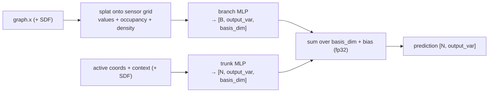

# 05 — DeepONet (fixed-sensor)

- **`model`**: `deeponet`
- **Directory / entrypoint**: [methods/Neural_Operator/](../../methods/Neural_Operator/) → `main.py`
- **Paper**: Lu, Jin, Pang, Zhang, Karniadakis, *Learning nonlinear operators via
  DeepONet based on the universal approximation theorem of operators*, Nature
  Machine Intelligence 3, 218–229 (2021).
- **Also read**: [00_shared_foundations.md](00_shared_foundations.md),
  [methods/Neural_Operator/CLAUDE.md](../../methods/Neural_Operator/CLAUDE.md) (authoritative)

DeepONet is the reference branch/trunk operator of the suite. The branch encodes
the input field, the trunk encodes a query location, and the prediction is their
inner product plus a bias, per output channel. The ragged mesh is splatted onto
a fixed regular sensor grid so the branch input has a fixed width for every mesh.
The splat's projection error is part of this baseline. For a model that reads
mesh points directly, see [Point-DeepONet](06_Point-DeepONet.md).

`deeponet`, `point_deeponet` and `fno` share one runtime, described once in
[Shared Neural-Operator runtime](#shared-neural-operator-runtime) below. Switching
between them changes only `model` and the model-specific keys.

## Architecture

Source: [model/deeponet.py](../../methods/Neural_Operator/model/deeponet.py) (`DeepONet`),
[model/adapters/grid.py](../../methods/Neural_Operator/model/adapters/grid.py) (`splat`),
[model/mlp.py](../../methods/Neural_Operator/model/mlp.py) (`build_deep_mlp`).



- **Branch**: `splat` deposits every `graph.x` column (state, conditions,
  positional features, node-type one-hot, optional SDF) onto a grid of
  `deeponet_sensor_resolution` cells, plus occupancy and density channels. The
  flattened grid feeds an MLP whose input width is
  `(total_node_dim + sdf) × ∏res + 2 × ∏res`. If the estimated first-layer
  parameter count exceeds `deeponet_max_branch_params` (default 1e8),
  construction fails.
- **Trunk**: an MLP over the active-axis normalized coordinates plus the context
  columns (`DataSpec.context_slice`: conditions, positional features, one-hot)
  and the optional SDF. The physical state never enters the trunk.
- **Output** (`split_both`): both nets emit `output_var × basis_dim`. `_decode`
  contracts them per channel in fp32 with autocast disabled.
- **Init**: Kaiming `init_weights`. For temporal data (T > 1) the last branch
  layer is scaled by 0.01.

## Model-specific keys

Required for training: `deeponet_sensor_resolution`, `deeponet_hidden_channels`,
`deeponet_branch_depth`, `deeponet_trunk_depth`, `deeponet_basis_dim`.

| Key | Default | Notes |
| --- | --- | --- |
| `deeponet_sensor_resolution` | — | one entry per active axis, each ≥ 2 (e.g. `32, 32`) |
| `deeponet_hidden_channels` | 256 | width of both MLPs |
| `deeponet_branch_depth` / `deeponet_trunk_depth` | 3 / 3 | |
| `deeponet_basis_dim` | 128 | modes per output channel |
| `deeponet_activation` | `silu` | `relu`, `silu`, `gelu`, `tanh` |
| `deeponet_max_branch_params` | 1e8 | guard on branch first-layer size |
| `deeponet_branch_source` | `fixed_sensors` | the only accepted value (`NOVAR-DEEP-BRANCH`) |
| `deeponet_multi_output` | `split_both` | the only accepted value (`NOVAR-DEEP-OUTPUT`) |

Checked-in profile:
[configs/Neural_Operator/deterministic/ex1/baseline/config_train_deeponet.txt](../../configs/Neural_Operator/deterministic/ex1/baseline/config_train_deeponet.txt)
(sensor resolution `32, 32`, hidden 256, depths 4/4, basis 128, `relu`).

## Limitations

- The branch sees only the splatted grid. Detail finer than one sensor cell is
  averaged away, and the branch input grows with `∏res`.
- `use_checkpointing` has no effect on DeepONet. Only FNO implements it.
- Global (per-sample) conditions are not wired: `deeponet_branch_source
  global_conditions` exists in the model code but the validators reject it.
  Use `cond_var` rows for known conditions.

---

## Shared Neural-Operator runtime

This section applies to `deeponet`, `point_deeponet` and `fno` alike.

### Code layout

| File | Role |
| --- | --- |
| [main.py](../../methods/Neural_Operator/main.py) | config load, mode dispatch, DDP spawn |
| [model/factory.py](../../methods/Neural_Operator/model/factory.py) | the only constructor (`MODEL_REGISTRY`, `build_model_from_checkpoint`) |
| [model/base.py](../../methods/Neural_Operator/model/base.py) | `OperatorCore` protocol: `forward`, `encode_operator`, `decode_queries`, `export_model_config` |
| [model/operator_wrapper.py](../../methods/Neural_Operator/model/operator_wrapper.py) | `OperatorWrapper`: noise injection and batch/ptr synthesis |
| [general_modules/data_spec.py](../../methods/Neural_Operator/general_modules/data_spec.py) | `DataSpec`: column slices of `graph.x` |
| [general_modules/mesh_dataset.py](../../methods/Neural_Operator/general_modules/mesh_dataset.py) | HDF5 loading, seeded 80/10/10 split, normalization |
| [training_profiles/](../../methods/Neural_Operator/training_profiles/) | single-GPU, DDP and AR-RT training loops |
| [parallelism/](../../methods/Neural_Operator/parallelism/) | `parallel_mode model_split` (FNO only) |
| [inference_profiles/rollout.py](../../methods/Neural_Operator/inference_profiles/rollout.py) | `run_rollout`: checkpoint-led inference |

### Data contract

All three models read the shared mesh HDF5 with no conversion; see
[DATASET_FORMAT.md](../reference/DATASET_FORMAT.md). Edges are used only for
positional features and plotting. No model consumes edge attributes.

- `graph.x` = `[state (input_var) | conditions (cond_var) | positional | node-type one-hot]`,
  sliced through `DataSpec` (`physical_slice`, `condition_slice`,
  `positional_slice`, `onehot_slice`, `context_slice`).
- Static data (T = 1): the target is the stored field and the state block is
  zeroed on input. Temporal data (T > 1): the target is `state[t+1] − state[t]`.
- `cond_var` rows are input only. They are never zeroed, get their own
  normalization statistics, and are carried unchanged through rollout.
- `operator_dim auto` resolves the active axes from the training geometry; a
  planar dataset becomes 2-D. Coordinates are mapped to `[0,1]^d` with
  `grid_padding` (default 0.05) and `out_of_bounds_policy` (`error` or `clamp`).
- An optional SDF channel comes from `sdf_source`: `none` (default), `dataset`,
  `sidecar` (needs `sdf_sidecar`) or `mesh`.
- `split_group_attr` groups samples before splitting, so related samples land in
  the same split.

### Modes

`mode train` and `mode inference`, both set inside the config.

| Mode | Required keys |
| --- | --- |
| `train` | `dataset_dir`, `modelpath`, `input_var`, `output_var`, `training_epochs`, `batch_size`, `learningr`, `coordinate_normalization`, plus the model's required keys |
| `inference` | `modelpath`, `infer_dataset`, `input_var`, `output_var` |

`coordinate_normalization` must be `centered_isotropic`.

Inference is checkpoint-led. The checkpoint supplies the architecture, data spec,
coordinate domain and normalization, and it is rejected if its model or schema
does not match the config. EMA weights are used when present. Static data needs
`infer_timesteps`; temporal data defaults to T − 1 rollout steps.

### Shared config keys

| Group | Keys (defaults) |
| --- | --- |
| Optimization | `learningr`, `weight_decay` (1e-4), `warmup_epochs` (3), `grad_accum_steps` (1), `max_grad_norm` (3.0). AdamW, then LinearLR warmup from 0.01×, then cosine to 1e-8. |
| Noise | `std_noise` (0.0), `noise_gamma` (1). The target correction ratio is derived from training statistics. |
| Runtime | `use_amp` (True, bf16), `use_ema` (False), `ema_decay` (0.999), `use_compile` (False), `use_checkpointing` (False; FNO only), `num_workers` (0), `prefetch_factor` (4), `augment_geometry` (False) |
| Time integration | `time_integration`: `ar_ot` (default; one-step teacher forcing) or `ar_rt` (full-trajectory unroll with per-step checkpointing, T > 1 only, [training_profiles/ar_rollout.py](../../methods/Neural_Operator/training_profiles/ar_rollout.py)). See [00_shared_foundations.md](00_shared_foundations.md). |
| Query chunking | `train_query_chunk_size`, `infer_query_chunk_size` (0 = off). Exact for all three models. |
| Evaluation | `val_interval` (1), `test_interval` (10), `test_max_batches` (200), `test_batch_idx`, `plot_feature_idx`, `display_testset` (True), `display_trainset` (True), `train_eval_subset_size` (128), `use_parallel_stats` (True) |
| Checkpointing | `checkpoint_interval` (0 = final only), `resume_training`, `resume_interval_minutes` (15) |
| Parallelism | `gpu_ids`; `parallel_mode` `ddp` (default) or `model_split` (FNO only, see [07_FNO.md](07_FNO.md)) |
| Profiling | `profile_batches` (0) writes `train_profile_trace.json` beside the log |

Fixed values: `write_preprocessing`, `use_world_edges` and `use_multiscale` must
be `False`. `global_condition_features` and `integration_weight_source` must be
`none`. MeshGraphNets/MGN-V keys (`latent_dim`, `message_passing_num`, `use_vae`, ...)
are errors (`NOVAR-REMOVED`). `write_test_predictions` is accepted but nothing
reads it.

`resume_training true` works for single-GPU training only. Multi-GPU training
(`ddp` or `model_split`) is rejected by `reject_multi_process`.

### Outputs

Checked-in configs write under
`output/dataset_matrix/deterministic/<slot>/<model>/`:

| Artifact | Path |
| --- | --- |
| checkpoint | `modelpath` (`model.pth`), written at the final epoch and every `checkpoint_interval` epochs |
| resume state | `<modelpath>.resume`, removed after the final checkpoint |
| epoch log | `log_file_dir` (`train.log`) |
| periodic test | `<log dir>/test/<gpu_ids>/<epoch>/sample*.h5` + PNG; `train/` with `display_trainset` |
| inference | `<inference_output_dir>/rollout_sample{id}_steps{N}.h5` (attrs `num_features`, `num_timesteps`, `output_var`; rows = coordinates, `output_var` fields, node type). Default dir: `output/neural_operator/rollout`. |

The checkpoint holds `schema_version`, `selected_model`, model and EMA state,
`model_config`, `adapter_config`, `data_config` and normalization.

### Tests and validation

```bash
python AI_CAE4ALL_main.py --config configs/Neural_Operator/deterministic/ex1/baseline/config_train_deeponet.txt --check
python AI_CAE4ALL_main.py --describe deeponet
cd methods/Neural_Operator && python -m pytest -q tests/
```

The tests use synthetic HDF5 fixtures (`tests/conftest.py`). Coverage includes
query-chunk parity (`test_query_chunking.py`), the noise contract, EMA BatchNorm
buffers, checkpoint round-trips, AR-RT and `model_split`.

Checked-in configs:
`configs/Neural_Operator/deterministic/{ex1,ex2,ex3_full,ex3_mid,ex4,...,ex9,ex10}/baseline/config_{train,infer}_{deeponet,point_deeponet,fno}.txt`.

Design notes: [MODEL_CAPABILITIES.md](../research/neural_operator/MODEL_CAPABILITIES.md)
(what each model can chunk, fp32 islands).
