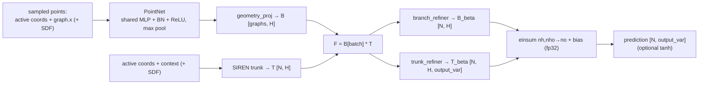

# 06 — Point-DeepONet

- **`model`**: `point_deeponet`
- **Directory / entrypoint**: [methods/Neural_Operator/](../../methods/Neural_Operator/) → `main.py`
- **Paper**: Park & Kang, *Point-DeepONet: Predicting Nonlinear Fields on
  Non-Parametric Geometries under Variable Load Conditions*, Neural Networks 198,
  108560 (2026), [arXiv:2412.18362](https://arxiv.org/abs/2412.18362).
- **Also read**: [05_DeepONet.md](05_DeepONet.md) (the
  [shared runtime](05_DeepONet.md#shared-neural-operator-runtime): data, modes,
  shared keys, outputs, tests), [00_shared_foundations.md](00_shared_foundations.md)

Point-DeepONet keeps DeepONet's branch/trunk product but replaces the sensor
grid with a PointNet over a fixed-size set of mesh points, and the trunk with a
SIREN. The branch and trunk are fused early and refined before the final product.
It reads mesh points directly, so it has no splat projection error, and its
branch input width does not depend on a grid resolution.

This is an MGN-adapted profile (`point_variant mesh_state`), not a reproduction
of the paper. Label its results "MGN-adapted Point-DeepONet". The differences
from the paper are listed in
[POINT_DEEPONET_PARITY.md](../research/neural_operator/POINT_DEEPONET_PARITY.md).

## Architecture

Source: [model/point_deeponet.py](../../methods/Neural_Operator/model/point_deeponet.py) (`PointDeepONet`),
[model/pointnet.py](../../methods/Neural_Operator/model/pointnet.py) (`PointNetEncoder`),
[model/siren.py](../../methods/Neural_Operator/model/siren.py) (`Siren`),
[model/adapters/point_sampling.py](../../methods/Neural_Operator/model/adapters/point_sampling.py) (`PointSampler`).

- **Sensors**: `PointSampler` draws `point_sensor_count` points per graph,
  seeded by `split_seed`, the sample id and the timestep. It resamples every epoch
  in training (`point_resample_each_epoch`) and is deterministic in evaluation.
  It samples with replacement when a mesh has fewer nodes than sensors.
  `point_sensor_count 0` uses every node (`PointNetEncoder.forward_segmented`).
- **Sensor features**: active-axis coordinates plus the full `graph.x` (state,
  conditions, positional features, one-hot) plus the optional SDF.
- **Trunk**: `Siren` over the active coordinates, context columns and optional
  SDF. It keeps its own sine-specific init and is excluded from the Kaiming
  `init_weights` pass.
- **Output**: `_decode` evaluates the einsum in fp32 with autocast disabled. For
  temporal data the last `branch_refiner` layer is scaled by 0.01.
- **BatchNorm under EMA**: the EMA update copies PointNet's BatchNorm running
  statistics as well as the parameters (`training_loop.py::update_ema`).

## Model-specific keys

Required for training: `point_sensor_count`, `point_hidden_channels`,
`point_feature_dim`, `pointnet_depth`, `point_trunk_depth`.

| Key | Default | Notes |
| --- | --- | --- |
| `point_sensor_count` | 5000 | 0 = all nodes |
| `point_resample_each_epoch` | True | |
| `point_hidden_channels` | 128 | hidden width of PointNet and refiners |
| `point_feature_dim` | 128 | shared latent width H |
| `pointnet_depth` | 3 | |
| `point_trunk_depth` | 3 | SIREN layers |
| `point_refiner_depth` | 2 | |
| `point_siren_omega0` | 30.0 | |
| `point_output_activation` | `identity` | or `tanh` (clips normalized targets to [-1, 1]) |
| `point_condition_depth` | 2 | unused while global conditions are unavailable |
| `point_variant` | `mesh_state` | the only accepted value |
| `point_sampling`, `pointnet_activation`, `pointnet_norm`, `point_branch_merge` | `random`, `relu`, `batch`, `sum` | single accepted value each (`NOVAR-POINT-CHOICE`) |

Checked-in profile:
[configs/Neural_Operator/deterministic/ex1/baseline/config_train_point_deeponet.txt](../../configs/Neural_Operator/deterministic/ex1/baseline/config_train_point_deeponet.txt)
(5000 sensors, H 128, depths 3/3/2, `point_siren_omega0 10`, identity output).

## Chunking

`encode_operator` runs the PointNet branch once per graph. `decode_queries` runs
the trunk, fusion, refiners and einsum over a node range, so
`train_query_chunk_size` / `infer_query_chunk_size` give the same result as an
unchunked decode.

## Limitations

- `point_variant paper` (geometry-only sensors, SDF trunk, global load
  conditions) is not executable. Both validators reject it because the dataset
  loader attaches no global conditions. Its code remains in `PointDeepONet`.
- `use_checkpointing` has no effect on Point-DeepONet. Only FNO implements it.
- The branch sees only the sampled points, so features smaller than the sensor
  spacing can be missed. `point_sensor_count` changes the model, not just its
  memory use: report it with every result.

Tests: `tests/test_point_deeponet.py`, `test_pointnet.py`, `test_siren.py`,
`test_point_sampling.py`, `test_ema_buffers.py`. Run them from
`methods/Neural_Operator` with `python -m pytest -q tests/`.
