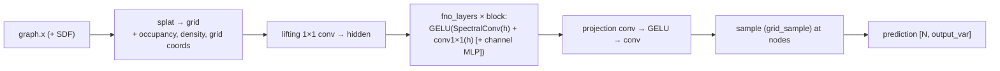

# 07 — FNO (mesh-adapted Fourier Neural Operator)

- **`model`**: `fno`
- **Directory / entrypoint**: [methods/Neural_Operator/](../../methods/Neural_Operator/) → `main.py`
- **Paper**: Li, Kovachki, Azizzadenesheli, Liu, Bhattacharya, Stuart, Anandkumar,
  *Fourier Neural Operator for Parametric Partial Differential Equations*, ICLR 2021.
- **Also read**: [05_DeepONet.md](05_DeepONet.md) (the
  [shared runtime](05_DeepONet.md#shared-neural-operator-runtime): data, modes,
  shared keys, outputs, tests), [00_shared_foundations.md](00_shared_foundations.md)

FNO learns the operator in Fourier space on a regular grid. Each layer applies a
truncated spectral convolution, which couples the whole domain in one step, plus
a pointwise path. To run on unstructured meshes, node data is splatted onto a
grid, the FNO runs there, and the output grid is sampled back at the nodes. The
spectral convolution is implemented natively; the `neuraloperator` package is
not a dependency.

## Architecture

Source: [model/fno.py](../../methods/Neural_Operator/model/fno.py) (`MeshFNO`),
[model/spectral.py](../../methods/Neural_Operator/model/spectral.py)
(`SpectralConvNd`, `validate_fno_modes`),
[model/adapters/grid.py](../../methods/Neural_Operator/model/adapters/grid.py) (`splat`, `sample`).

- **Input grid** (`fno_variant mesh`): the splatted `graph.x` columns, occupancy,
  density, the `[0,1]^d` grid coordinates and the optional SDF. That is
  `total_node_dim + 2 + d (+1)` channels on a `fno_grid_resolution` grid.
- **Spectral convolution**: `SpectralConvNd` keeps the lowest `fno_modes`
  frequencies per axis. The FFT runs in fp32 with autocast disabled. Weights are
  real tensors with a trailing size-2 dimension, viewed as complex only inside
  `forward`, because fused AdamW rejects complex parameters. Mode limits:
  `modes ≤ resolution // 2` on leading axes and `≤ resolution // 2 + 1` on the
  last axis (`NOVAR-FNO-001`).
- **Block**: spectral path plus a pointwise 1×1 conv, an optional residual
  channel MLP (`fno_use_channel_mlp`), then GELU.
- **Decode**: `sample` interpolates the output grid at each node's normalized
  coordinate. Read the axis-order note at the top of `grid.py` before editing it.
- **Init**: for temporal data the last projection layer is scaled by 0.01.
- **Checkpointing**: `use_checkpointing True` recomputes each FNO block in
  backward (`MeshFNO._forward_grid_stack`). FNO is the only Neural-Operator model
  that implements it.

## Model-specific keys

Required for training: `fno_grid_resolution`, `fno_modes`, `fno_hidden_channels`,
`fno_layers`.

| Key | Default | Notes |
| --- | --- | --- |
| `fno_grid_resolution` | — | one entry per active axis, each ≥ 2 |
| `fno_modes` | — | per axis, within the mode limits above |
| `fno_hidden_channels` | 64 | |
| `fno_layers` | 4 | |
| `fno_use_channel_mlp` | True | |
| `fno_norm` | `none` | the only accepted value |
| `fno_variant` | `mesh` | or `paper_darcy` (below) |
| `pipeline_microbatches` | 2 × stages | `model_split` only |

Checked-in profile:
[configs/Neural_Operator/deterministic/ex1/baseline/config_train_fno.txt](../../configs/Neural_Operator/deterministic/ex1/baseline/config_train_fno.txt)
(grid `64, 64`, modes `12, 12`, hidden 32, 4 layers, `fno_use_channel_mlp False`).

### `parallel_mode model_split`

FNO only. [parallelism/launcher.py](../../methods/Neural_Operator/parallelism/launcher.py)
splits the core into pipeline blocks across GPUs: entry (splat + lifting), the
FNO blocks, and exit (projection + sample). It runs a 1F1B schedule over
`pipeline_microbatches`. Each stage is a seeded full core pruned to its block
range (`prune_to_pipeline_blocks`), so state-dict keys do not change and the
merged checkpoint loads through normal inference. It needs at least two
`gpu_ids` and `augment_geometry False`, and it cannot resume.

### `fno_variant paper_darcy`

A strict reproduction profile of the original 2-D Darcy-flow FNO. Its input is
`[coefficient, x, y]` on an exact 85×85 grid. It uses ReLU after the first three
of four blocks, a 128-wide projection, U(0, 1/(in·out)) spectral init, Adam with
StepLR (×0.5 every 100 epochs, no warmup) and a decoded per-sample relative L2
loss. `MeshFNO`'s validator rejects any deviation: `operator_dim 2`,
`input_var 1`, `output_var 1`, T = 2, no positional features, node types or SDF,
modes `12, 12`, hidden 32, 4 layers, 500 epochs, batch 20, lr 1e-3, weight decay
1e-4, no channel MLP, AMP, EMA, noise or augmentation, `ddp`.

## Limitations

- The splat and sample round trip limits resolution to the grid cell size, and
  boundaries are blurred by bilinear/trilinear interpolation. Grid cost grows with
  `∏res × fno_hidden_channels`.
- The truncated spectrum smooths sharp local features.
- `fno_grid_resolution` and `fno_modes` change the model, not just its memory
  use: report them with every result.
- No checked-in config or dataset converter uses `paper_darcy`. Only
  `tests/test_fno_paper_validation.py` exercises it.

Tests: `tests/test_fno.py`, `test_spectral.py`, `test_grid_adapter.py`,
`test_model_split.py`, `test_fno_paper_validation.py`. Run them from
`methods/Neural_Operator` with `python -m pytest -q tests/`.
