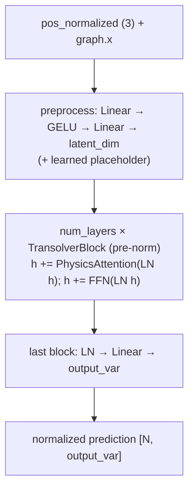

# 08 — Transolver (Physics-Attention transformer)

- **`model`**: `transolver`
- **Directory / entrypoint**: [methods/Transolver/](../../methods/Transolver/) → `Transolver_main.py`
- **Paper**: Wu, Luo, Wang, Wang, Long, *Transolver: A Fast Transformer Solver for
  PDEs on General Geometries*, ICML 2024. The default kernel uses Transolver-3's
  aggregate-then-project reformulation.
- **Also read**: [00_shared_foundations.md](00_shared_foundations.md)

Transolver is a transformer that attends over a small set of learned physics
slices instead of over node pairs. Each node is softly assigned to `slice_num`
slices per head. Node features are aggregated into slice tokens, self-attention
runs among the tokens, and the result is scattered back to the nodes. Cost is
linear in the node count and every layer has a global receptive field. It reads
node coordinates and features only, with no mesh edges.

## Architecture

Source: [model/Transolver.py](../../methods/Transolver/model/Transolver.py) (`Transolver`),
[model/physics_attention.py](../../methods/Transolver/model/physics_attention.py)
(`PhysicsAttentionIrregular`), [model/blocks.py](../../methods/Transolver/model/blocks.py)
(`TransolverBlock`, `FFN`).



- **Input**: `graph.x` = `[state | conditions (cond_var) | positional | node-type one-hot]`
  plus 3 normalized coordinates. Noise (`std_noise`, `noise_gamma`) is added to
  the first `output_var` channels in training.
- **Physics-Attention**, per graph (segmented by `ptr`): slice logits divided by
  a per-head temperature clamped to `[temperature_min, temperature_max]`, a
  softmax over slices, aggregation into tokens as `num/den` in fp32, token
  self-attention, then deslicing back to nodes.
- **Kernels** (`attention_kernel`), numerically equivalent with the same weights:
  - `slice_space` (default): aggregate-then-project, with an optional tiled
    two-pass form (`chunk_size`). Tiling, `node_shard` and amortized training
    require it. Decoupled inference always runs the slice-space math, whichever
    kernel was trained.
  - `naive`: project-then-aggregate, the original v1 order.
- **Block**: pre-norm residual attention and `FFN` (Linear, GELU, Linear with
  width `latent_dim × mlp_ratio`). Weights are truncated-normal initialized, and
  slice projectors are re-initialized orthogonal afterwards. `small_output_init`
  scales the head by 0.01. It defaults to True for temporal data or unknown T,
  and False for static data.
- **Checkpointing**: `use_checkpointing` recomputes blocks in backward
  ([model/checkpointing.py](../../methods/Transolver/model/checkpointing.py)).
  It is independent of `chunk_size`: a tiled forward already streams attention
  memory.

Attention memory scales with batch × layers × heads × N × `slice_num`, not with
`latent_dim`.

## Data contract

Transolver reads the shared mesh HDF5 with no conversion; see
[DATASET_FORMAT.md](../reference/DATASET_FORMAT.md). Static data (T = 1) predicts
the stored field. Temporal data predicts normalized deltas and rolls out
autoregressively. `cond_var` rows are input only and carried unchanged through
rollout. Splits are seeded by `split_seed`, and `split_group_attr` groups related
samples ([general_modules/grouped_split.py](../../methods/Transolver/general_modules/grouped_split.py)).

## Modes and keys

`mode train` and `mode inference`, both set inside the config.

| Mode | Required keys |
| --- | --- |
| `train` | `dataset_dir`, `modelpath`, `input_var`, `output_var`, `training_epochs`, `batch_size`, `learningr`, `coordinate_normalization`, `latent_dim`, `num_layers`, `num_heads`, `slice_num`, `attention_kernel` |
| `inference` | `modelpath`, `infer_dataset`, `input_var`, `output_var` |

Model and parallelism keys:

| Key | Default | Notes |
| --- | --- | --- |
| `latent_dim`, `num_heads` | — | `latent_dim % num_heads == 0` (`TRANS-HEADS-001`) |
| `num_layers`, `slice_num` | — | |
| `attention_kernel` | `slice_space` | or `naive` |
| `chunk_size` | 0 | node tile size; > 0 requires `slice_space` (`TRANS-CHUNK-001`) |
| `mlp_ratio` | 1 | |
| `dropout` | 0.0 | |
| `temperature_init` / `_min` / `_max` | 0.5 / 0.1 / 5.0 | `0 < min ≤ init ≤ max` |
| `small_output_init` | see above | |
| `amortized_training` | False | see below |
| `amortized_cache_nodes` / `amortized_query_nodes` | 0 / 0 | 0 = full mesh |
| `infer_mode` | `direct` | or `decoupled` |
| `infer_chunk_size` | 0 | used by `infer_mode decoupled` only |
| `parallel_mode` | `ddp` | or `node_shard` (`model_split` is an alias) |
| `max_train_batches` / `max_val_batches` | 0 | per-epoch caps, `node_shard` only |

Shared keys: `split_seed`, `feature_loss_weights`, `positional_features`,
`use_node_types`, `learningr`, `weight_decay`, `warmup_epochs`,
`grad_accum_steps`, `max_grad_norm`, `num_workers`, `prefetch_factor`,
`std_noise`, `noise_gamma`, `augment_geometry`, `use_amp`, `use_ema`,
`ema_decay`, `use_compile`, `use_parallel_stats`, `time_integration` (`ar_ot`
or `ar_rt`, see below), and the evaluation keys `val_interval`, `test_interval`,
`test_max_batches`, `test_batch_idx`, `plot_feature_idx`, `display_testset`,
`display_trainset`, `write_test_predictions`.

Fixed values: `coordinate_normalization centered_isotropic`, `use_world_edges
False`, `use_multiscale False`. `write_preprocessing True` is allowed only when
training on a `*_transolver_runtime.h5` copy (`TRANS-WRITE-001`). MeshGraphNets
keys (`message_passing_num`, `edge_var`, ...) are errors (`TRANS-MGN-KEY`).

### Options

- **`parallel_mode node_shard`**: one mesh's nodes are split across ranks
  ([training_profiles/sharded_training.py](../../methods/Transolver/training_profiles/sharded_training.py)).
  Slice aggregates (`num`, `den`) are SUM all-reduced differentiably, so every
  rank sees whole-graph tokens. It needs `slice_space` and at least two `gpu_ids`.
- **`amortized_training`**: each layer builds tokens from a subsampled cache
  stream and decodes and scores a smaller query stream
  ([model/amortized.py](../../methods/Transolver/model/amortized.py),
  `Transolver.forward_amortized`). The estimate is consistent but not exact, so
  it is used in training only. It needs `slice_space` and a nonzero stream size,
  and is incompatible with `ar_rt` and `node_shard` (`TRANS-AMORT-001..004`).
- **`time_integration ar_rt`**: unrolls the full trajectory with per-step
  gradient checkpointing and no detach, following arXiv:2510.15201
  ([training_profiles/ar_rollout.py](../../methods/Transolver/training_profiles/ar_rollout.py)).
  Requires T > 1.
- **`infer_mode decoupled`**: builds a per-layer token cache, then decodes
  against it (`Transolver.forward_decoupled`,
  [inference_profiles/decoupled.py](../../methods/Transolver/inference_profiles/decoupled.py)).
  Static datasets only. The query set is the cache mesh itself, so the result
  equals the direct forward.
- **`resume_training`** / **`resume_interval_minutes`**: single-GPU training
  only. Multi-GPU training (`ddp` or `node_shard`) is rejected by
  `reject_multi_process`.

Checked-in profiles:
`configs/Transolver/deterministic/{ex1,ex2,ex3_full,ex3_mid,ex4,...,ex9,ex13}/baseline/config_{train,infer}_transolver3.txt`.
Every training config uses `slice_space`, `slice_num 64`, `chunk_size 4096` and
`ddp`. For example,
[ex2](../../configs/Transolver/deterministic/ex2/baseline/config_train_transolver3.txt)
uses `latent_dim 256`, `num_layers 8`, `num_heads 8`, `mlp_ratio 2`, `use_amp True`
and `use_checkpointing True`.

## Outputs

Checked-in configs write under
`output/dataset_matrix/deterministic/<slot>/transolver3/`.

| Artifact | Path |
| --- | --- |
| checkpoint | `modelpath` (`model.pth`), written at the final epoch |
| resume state | `<modelpath>.resume` |
| epoch log | `log_file_dir` (`train.log`) |
| periodic test (`display_testset`) | `<log dir>/test/<gpu_ids>/<epoch>/` mesh HDF5 + 2×2 PNG; `train/` with `display_trainset` |
| prediction dumps (`write_test_predictions`) | `<log dir>/dumps/<prefix>/<gpu_ids>/<epoch>/` coordinates + denormalized prediction/target |
| inference | `<inference_output_dir>/rollout_sample{id}_steps{N}.h5`; default dir `output/transolver/rollout` |

Inference is checkpoint-led: architecture and normalization come from the
checkpoint (`TRANS-CKPT-001`).

## Tests and validation

```bash
python AI_CAE4ALL_main.py --config configs/Transolver/deterministic/ex2/baseline/config_train_transolver3.txt --check
python AI_CAE4ALL_main.py --describe transolver
cd methods/Transolver && python -m pytest -q tests/
```

Tests: `test_transolver3_paths.py` (tiled direct forward vs decoupled inference,
amortized target/gradient alignment), `test_conditioning.py` (`cond_var`,
including AR-RT),
`test_node_type_layout.py`, `test_grouped_split.py`. The scripts in
[misc/](../../methods/Transolver/misc/) (`verify_against_official.py`,
`verify_v3.py`, `bench_attention_kernels.py`) compare against the reference
implementation and benchmark the kernels; they are not part of the test suite.

## Limitations

- No explicit local operator: everything passes through the global slice tokens,
  so sharp local features depend on the slice softmax resolving them. Too few
  slices under-resolve; too many cost memory.
- `infer_mode decoupled` is static-only and embeds the mesh twice, so it saves
  nothing yet over `direct`.
- `infer_chunk_size` does nothing under `infer_mode direct`, even though the
  checked-in configs set it.
- [model/paper_elasticity.py](../../methods/Transolver/model/paper_elasticity.py)
  (`PaperElasticityTransolver`, the paper's Elasticity benchmark profile) is not
  reachable from the entrypoint or any config.
- Autoregressive error accumulates as in every one-step simulator; `ar_rt`
  trains against it at the cost of a full-trajectory unroll.

Design notes (Korean): [FOUNDATION_MODEL_DESIGN.md](../research/transolver/FOUNDATION_MODEL_DESIGN.md).
