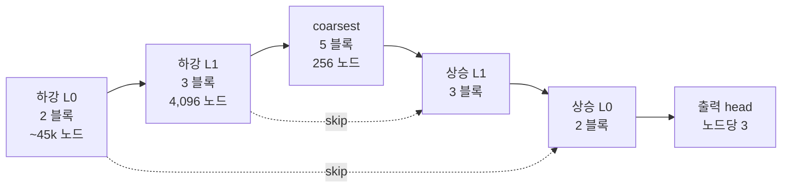

# HI-MGN 잠재 배치 비교: 구조 분석과 실험 계획

- 작성일: 2026-10-13
- 대상 문제: ex3 원통 쉘 좌굴 (`dataset/probabilistic/ex3_shell_buckling*.h5`)
- 상태: **계획 문서. 학습 결과는 아직 없음.** 이 문서의 숫자는 모두 체크인된 설정 파일, 코드, 데이터셋 속성에서 직접 읽은 값이다.
- 근거 자료: 외부 검토서 `output/research/2026-10-13_one_to_many/LATENT_PLACEMENT_ARTIFACT_REVIEW_KR.md` (이하 "검토"; 절 번호는 검토서의 번호), 코드 위치는 [부록 A](#부록-a-코드-위치)

이 문서의 목적은 세 가지다.

1. 세 모델(HI-MGN-V, HI-MGNflow, HI-MGN-hybrid)이 **z를 어디에 두고, 각 노드가 z를 어떻게 읽는지**를 코드 수준에서 정확히 기록한다.
2. hybrid가 **노드별 잠재와 전역 잠재를 한 번에 얻고, 한 번에 생성하는 방법**을 설명한다.
3. 검토 의견 가운데 받아들일 것과 대안을 정하고, 그 위에서 **무엇을 학습하고 무엇과 비교할지** 순서와 판정 기준을 정한다.

---

## 목차

1. [문제 설정](#1-문제-설정)
2. [이름과 고정 식별자](#2-이름과-고정-식별자)
3. [공통 골격: 계층 V-cycle](#3-공통-골격-계층-v-cycle)
4. [HI-MGN-V: 그래프 전역 slot](#4-hi-mgn-v-그래프-전역-slot)
5. [HI-MGNflow: coarse 노드별 국소 잠재](#5-hi-mgnflow-coarse-노드별-국소-잠재)
6. [HI-MGN-hybrid: 국소 + 전역을 한 번에](#6-hi-mgn-hybrid-국소--전역을-한-번에)
7. [노드별 주입 지도](#7-노드별-주입-지도)
8. [세 모델 비교 요약과 교란 요인](#8-세-모델-비교-요약과-교란-요인)
9. [검토 의견 판단](#9-검토-의견-판단)
10. [연구 질문과 가설](#10-연구-질문과-가설)
11. [실험 arm과 순서](#11-실험-arm과-순서)
12. [평가 프로토콜](#12-평가-프로토콜)
13. [승인이 필요한 코드와 설정](#13-승인이-필요한-코드와-설정)
14. [위험과 해석상 함정](#14-위험과-해석상-함정)
15. [논문 문장](#15-논문-문장)
- [부록 A. 코드 위치](#부록-a-코드-위치)
- [부록 B. 설정 파일 대조](#부록-b-설정-파일-대조)

---

## 1. 문제 설정

### 1.1 물리 설정

```text
             imposed end-shortening Δ  (node type 2: loaded)
          ═══════════════════════════════
          │                             │
          │    ◜ dimple imperfection    │      R  : 반경
          │    (진폭 a, 폭 σ,           │      t  : 두께
     L    │     위치 z_d, θ_d)          │      L  : 길이
          │                             │      Δ  : 축방향 강제 단축
          │                             │
          ═══════════════════════════════
             clamped  (node type 1)
```

- 같은 공칭 조건 (R, t, L, Δ)에서 **관측되지 않은 초기결함(dimple)**만 다르게 64번 해석했다. 응답장의 산포는 이 미지의 입력 산포에서 나온다. 같은 입력을 반복해서 생기는 시간적 무작위성은 없다.
- 모델 입력 x: 공칭 좌표, 두께 t와 강제 단축 Δ(조건 행, `cond_var 2`), node type. **결함 파라미터는 입력에 없다.**
- 모델 출력 y: 최종 변위장 (u_x, u_y, u_z), 노드당 3개.

### 1.2 데이터 (HDF5 속성에서 읽은 값)

| 항목 | 학습 파일 `ex3_shell_buckling.h5` | OOD 파일 `ex3_shell_buckling_infer.h5` |
| --- | --- | --- |
| 형상 수 × 결함 draw | 150 × 64 = 9,600 | 8 × 64 = 512 |
| R [mm] | 100.4 – 199.9 | 80 – 240 |
| t [mm] | 1.005 – 1.994 | 0.8 – 2.4 |
| L [mm] | 150.4 – 299.4 | 120 – 350 |
| Δ [mm] | 1.003 – 2.995 | 0.6 – 3.6 |
| 결함 진폭 a [mm] | −1.02 – 1.03 | 같은 분포 (같은 draw 번호) |
| 노드 수 / 메시 | 27,980 – 87,400 (중앙값 45,410) | 24,850 – 85,970 |
| 좌굴한 샘플 비율 | 0.879 | 0.748 |
| 최대 반경 변위 / t | 0.11 – 15.1 (중앙값 5.5) | 0.09 – 16.3 (중앙값 6.2) |

행 배치 (`row_layout` 속성): `0:3` 공칭 좌표 | `3:6` 최종 변위(출력) | `6` 두께 | `7` Δ | `8` node type (0 내부, 1 고정, 2 하중).

OOD 파일은 결함 분포는 그대로 두고 **형상과 하중 범위를 바깥으로 넓힌** 외삽 세트다(tier `t1`). 따라서 OOD 평가는 "본 적 없는 결함 분포"가 아니라 "본 적 없는 공칭 조건에서의 조건부 분포"를 잰다.

학습/검증 분할은 `split_seed 42`, `split_group_attr shape_idx`이다. 검증 형상은 64개 draw를 모두 가지므로, **검증 세트 안에서 조건별 반복 FEA 분포가 이미 존재한다.** 12절의 평가는 이 점에 기대고 있다.

---

## 2. 이름과 고정 식별자

표시 이름은 잠재의 위치를 따른다. 기존 설정과 체크포인트가 깨지지 않도록 코드 식별자는 옛 철자를 유지한다.

| 표시 이름 | 잠재 | route (`model`) | 구분 키 |
| --- | --- | --- | --- |
| **HI-MGN-V** | 전역 (그래프당 level별 slot) | `meshgraphnets-v` | `use_multiscale true` |
| **HI-MGNflow** (구 cHI-MGNflow) | 국소 (coarse 노드별) | `chi-mgnflow` | `latent_type local` |
| **HI-MGN-hybrid** | 국소 + 전역 | `chi-mgnflow` | `latent_type hybrid` |

고정 식별자: route `chi-mgnflow`, `config_*_chi_mgnflow.txt`, `cae_suite/specs/chi_mgnflow.py`, `CHiMGNFlow` 클래스, `CHiMGNFlow_main.py`, `output/chi-mgnflow/`.

이름 변경은 저장소 전체(문서, 설정 주석, 논문 원고, Studio, 테스트)에 반영했다. `--audit-configs` (401개 파일, 오류 0), Studio backend 테스트, HI_MGNFlow 테스트 20개, MGN-V 테스트 67개가 모두 통과했다. 논문 폴더는 `paper/HI-MGNflow/`이며 PDF는 다시 컴파일해야 새 이름이 반영된다.

---

## 3. 공통 골격: 계층 V-cycle

세 모델은 같은 계층 메시 GNN 골격을 쓴다. ex3 설정은 모두 같다.

| 키 | 값 | 의미 |
| --- | --- | --- |
| `latent_dim` | 128 | 노드/엣지 은닉 폭 |
| `multiscale_levels` | 2 | 미세 L0 → L1 → coarsest |
| `coarsening_type` | `voronoi_seedmean` | Voronoi 군집 |
| `voronoi_clusters` | 4096, 256 | L1 = 4,096 노드, coarsest = 256 노드 (그래프당) |
| `mp_per_level` | 2, 3, 5, 3, 2 | 하강 L0, 하강 L1, coarsest, 상승 L1, 상승 L0의 GnBlock 수 |
| `hierarchy_variants` | 2 | 형상마다 계층 2벌을 미리 만들어 번갈아 사용 |
| `hierarchy_seed` / `training_seed` | 42 / 42 | 계층 생성과 학습 난수 |
| `batch_size` / `grad_accum_steps` | 2 / 4 | |
| `use_amp`, `use_checkpointing`, `use_ema` | True | EMA decay 0.99 |



세 모델의 차이는 이 골격 위에 **z를 어디에 붙이는가**, **z를 어떻게 추론하는가**(사후 인코더), **z를 어떻게 생성하는가**(prior)에 있다.

---

## 4. HI-MGN-V: 그래프 전역 slot

### 4.1 잠재

- 모양: `z ∈ [B, num_z, vae_latent_dim] = [B, 3, 32]`. `num_z`의 기본값은 `multiscale_levels + 1` = 3 (`MeshGraphNets.py:263`).
- 그래프당 확률 좌표 수: **96**.
- slot과 level의 대응: slot 0 → L0, slot 1 → L1, slot 2 → coarsest.

### 4.2 사후 인코더와 정규화

- `GNNVariationalEncoder`: 미세 메시에서 x와 y를 함께 읽는 MP 3층(`vae_mp_layers 3`, `vae_graph_aware True`) → attention pool → slot별 (μ, σ).
- `posterior_min_std 0.05`로 사후 표준편차에 하한을 둔다.
- 정규화는 ELBO의 KL이 아니라 **aggregate MMD** (`lambda_mmd 1`, `mmd_bandwidth median`)와 보조항(`beta_aux 10`)이다. 재구성 가중치는 `alpha_recon 1000`이다.

### 4.3 decoder에서 노드가 z를 읽는 방식

`_forward_multiscale`(`MeshGraphNets.py:477`)에서, 각 level의 블록에 들어가기 직전에 그 level의 slot을 노드로 펼친다.

```python
# HI-MGN-V: 그래프 단위 slot. 같은 그래프 안의 모든 노드가 같은 벡터를 받는다.
z = sample()                                   # [B, 3, 32]
z_node = z[:, 0][batch_L0]                     # slot 0 → L0의 모든 노드
for blk in pre_blocks[L0]:  h = AdaLN(blk)(h, z_node)        # 하강 L0 (2)
skip[L0] = (h, z_node)                         # 상승 때 같은 slot을 다시 쓰려고 보관
h = pool(h);  z_node = z[:, 1][batch_L1]       # MeshGraphNets.py:542-543
for blk in pre_blocks[L1]:  h = AdaLN(blk)(h, z_node)        # 하강 L1 (3)
skip[L1] = (h, z_node)
h = pool(h);  z_node = z[:, 2][batch_C]
for blk in coarsest_blocks: h = AdaLN(blk)(h, z_node)        # coarsest (5)
for ℓ in (L1, L0):                             # 상승
    h = skip_proj(cat[skip[ℓ].h, unpool(h)])
    for blk in post_blocks[ℓ]: h = AdaLN(blk)(h, skip[ℓ].z_node)  # 3, 2
ŷ = head(h)
```

- `z_conditioning adaln`: 각 블록의 scale/shift/gate를 z_node에서 계산한다(AdaLN-Zero, 초기에는 항등).
- **z가 들어가는 블록은 15개 전부**(2 + 3 + 5 + 3 + 2)다. 하강 구간도 z를 받는다. V에서는 하강 패스가 prior의 조건으로 재사용되지 않으므로 순환이 생기지 않는다.
- 같은 그래프 안에서 z_node는 노드마다 같다. 노드별 차이는 x와 메시 위치에서만 나온다. z는 "이 그래프 전체가 어떤 응답 패턴을 고르는가"만 정할 수 있다.

### 4.4 prior

- `ConditionalFMPrior` (`conditional_prior.py:180`), `prior_type gnn_e2e`, `prior_family fm`.
- 조건 trunk: x 위에서 MP 3층(`prior_mp_layers 3`) → pool → c ∈ ℝ¹²⁸ (`prior_hidden_dim 128`).
- velocity: 96차원 평탄 벡터 전체에 대한 MLP. slot 3개를 **한 벡터로 함께** 모델링하므로 slot 사이 상관이 유지된다.
- 적분: Heun 30 step (`prior_fm_steps 30`).
- `prior_grad_to_encoder 0.0`: prior의 gradient는 사후 인코더로 가지 않는다.

### 4.5 학습 일정

한 번의 학습(120 epoch) 안에서 두 구간으로 나뉜다.

| epoch | 학습 대상 |
| --- | --- |
| 0 – 80 | 사후 인코더 + decoder(simulator) + prior를 함께. prior는 사후 표본을 따라가지만 인코더에 gradient를 주지 않는다 |
| 80 – 120 | `prior_freeze_epoch 80`: simulator를 고정하고, 고정된 사후 분포로 z 표준화(shift/scale)를 한 번 맞춘 뒤 prior만 새 cosine 일정으로 학습 |

---

## 5. HI-MGNflow: coarse 노드별 국소 잠재

### 5.1 잠재

- 모양: `z_l ∈ [n_c, latent_ch] = [256·B, 4]`.
- 그래프당 확률 좌표 수: **1,024** (256 × 4).
- z_l[c]는 coarsest 노드 c(약 45,000/256 ≈ 180개 미세 노드의 영역)에 붙은 4차원 벡터다.

### 5.2 사후 인코더: 같은 가중치로 두 번

`encode_both` (`CHiMGNFlow.py:393`):

```python
h_y, cb = HierarchyEncoder(x ⊕ y)         # 1회차: y를 입력에 포함 (하강 L0 → L1 → coarsest)
mu_l, logvar_l = latent_head(h_y)         # [256, 128] → [256, 2·4]
logvar = clamp(logvar, -10, 10)
outs_0, cb = HierarchyEncoder(x ⊕ 0)      # 2회차: 같은 가중치, y 자리에 0
```

- 1회차의 coarsest 특징 h_y만 z_l로 간다.
- 2회차 결과 `outs_0`(level별 특징)은 **y를 보지 않은 조건 인코딩**이다. decoder의 skip 연결과 prior의 조건이 모두 이 결과를 읽는다. 그래서 정답 y가 skip을 통해 decoder로 새지 않고, 생성 때에도 같은 경로를 그대로 쓸 수 있다.

### 5.3 decoder에서 노드가 z를 읽는 방식

`decode` (`CHiMGNFlow.py:471`)와 `coarsest_parent_maps` (`autoencoder.py:121`):

```python
outs_0 = ctx.levels                            # y=0 조건 패스 결과 (조건당 1회 계산)
h = outs_0.coarsest.x                          # [256, 128]
# coarsest 진입: coarse 노드 c는 자기 z_l[c]를 concat으로 받는다
h = z_fuse(cat[h, z_lift(z_l)])                # z_lift: 4 → 128, z_fuse: 256 → 128
h = post_z_blocks(h)                           # 5 블록. local에서는 z 변조 없음
# 상승: 각 노드는 자기 coarsest 조상의 z_l을 AdaLN으로 받는다
anc = coarsest_parent_maps(level_data)         # ftc 사상을 합성
#   anc[L1][i] = ftc_L1[i]                     (L1 노드 i → coarsest 노드)
#   anc[L0][i] = ftc_L1[ ftc_L0[i] ]           (L0 노드 i → L1 부모 → coarsest 조상)
for ℓ in (L1, L0):
    h = skip_proj(cat[outs_0[ℓ], unpool(h)])
    for blk in level ℓ:
        h = AdaLN(blk)(h, z_l[anc[ℓ]])         # 같은 조상을 둔 노드끼리 같은 z_l
ŷ = head(h)
```

- 미세 노드 i가 받는 z는 **자기 영역(coarsest 조상)의 4차원 z_l**이다. V처럼 그래프 전체에 하나가 아니라 영역마다 다르다.
- 영역 경계에서는 z_l 값이 계단처럼 바뀐다. 상승 구간의 message passing(L1 3 블록, L0 2 블록)이 이 경계를 평활화한다.

### 5.4 학습 목적

`ae_loss` (`training_loop.py:168`):

```text
loss_AE = MSE(ŷ, y) + ae_kl_weight · mean_{모든 잠재 원소} KL( N(μ, σ²) ‖ N(0, I) )
        ae_kl_weight = 1e-6
```

- KL은 합이 아니라 **원소 평균**이다. 1e-6 가중치와 합쳐서 bottleneck은 사실상 정규화하지 않고 잠재의 크기만 맞춘다(prior가 학습할 수 있는 범위로).
- 따라서 HI-MGNflow는 VAE보다는 **결정론에 가까운 압축기 + 잠재 공간 생성 모델**(LDGN 계열)이다.

### 5.5 prior

`LatentFlowPrior` (`autoencoder.py:297`):

```python
def velocity(z_t, t):                          # z_t: [256·B, 4]
    x = in_proj(cat[z_t, cond_x])              # cond_x = outs_0.coarsest.x (y=0 조건 특징)
    for j in 1..4:                             # prior_blocks 4
        x = AdaLN_t(GnBlock_j)(x)              # coarse 그래프 위 이웃 message passing, 시간 t로 변조
    return out_head(x)                         # [256·B, 4]
```

- 계산은 coarsest 그래프(256 노드)에서만 일어난다. 미세 메시는 생성 1회당 한 번(조건 인코딩)과 decode 한 번만 지난다.
- 수용 영역은 velocity 1회 평가 기준 4 hop이다. ODE 30 step 동안 정보는 더 멀리 전달되지만, **한 step 안에서 멀리 떨어진 영역끼리 직접 맞추는 경로는 없다.** "먼 위치 사이의 결합이 약할 수 있다"는 가설(검토 §3.2)은 token 대조군(11절)으로 검증한다.

### 5.6 flow 경로와 학습 일정

`sample_path` (`flow.py`):

```text
t ~ U(0,1)   그래프마다 하나 (노드마다 다르면 어떤 경로 위에도 없는 상태가 된다)
z0 ~ N(0, I),   z1 ~ q(z | y)   (고정된 AE의 사후 표본)
s  = 1 − σ_min
z_t = (1 − s·t)·z0 + t·z1
u   = z1 − s·z0                                (회귀 목표 속도)
loss_prior = mean ‖ velocity(z_t, t) − u ‖²
```

한 프로세스(`mode train`)에서 두 단계를 연달아 돈다.

| 단계 | epoch | 학습 대상 |
| --- | --- | --- |
| 1 | `ae_epochs 60` | 압축기(HierarchyEncoder, latent_head, decoder) |
| 2 | `training_epochs 120` | 압축기 고정, prior만 |

`mode train_prior`에 `ae_checkpoint`를 주면 이미 학습한 압축기를 고정한 채 prior만 학습할 수 있다(`CHiMGNFlow.py:91`). 체크포인트 안의 `model.prior.*` 가중치는 버리고 나머지만 불러온다. L-token 대조군(11절)이 이 경로를 쓴다.

### 5.7 생성

```python
ctx = encode_condition(x)                      # y=0 하강 패스 1회
z0  = randn(256·B, 4)
z1  = Heun(velocity, z0, steps=30)             # coarse 그래프에서만
ŷ   = decode(z1, ctx)
```

---

## 6. HI-MGN-hybrid: 국소 + 전역을 한 번에

### 6.1 잠재

- `z_l ∈ [256·B, 4]` (HI-MGNflow와 같음) + `z_g ∈ [B, 32]` (`global_latent_dim 32`).
- 그래프당 확률 좌표 수: **1,056** (1,024 + 32).
- z_g는 그래프당 **하나의 공유 벡터**다. V처럼 level별 slot이 아니다(검토 §3.3, §6.2).

### 6.2 사후: 같은 trunk에 head 두 개

```python
h_y, cb = HierarchyEncoder(x ⊕ y)                   # y 포함 하강 패스 1회
mu_l, logvar_l = latent_head(h_y).chunk(2)          # [256, 4]   노드별 head
pooled = AttentionalAggregation(h_y, cb)            # [B, 128]   같은 h_y에서 그래프 요약
mu_g, logvar_g = global_head(pooled).chunk(2)       # [B, 32]
mu     = pack(mu_l, mu_g)                           # [256·B + 8·B, 4]
logvar = pack(logvar_l, logvar_g).clamp(-10, 10)
z = mu + exp(0.5·logvar) · ε                        # reparameterization 한 번으로 둘 다
outs_0, cb = HierarchyEncoder(x ⊕ 0)                # 조건 패스 (local과 동일)
ŷ = decode(z, outs_0)
loss = MSE(ŷ, y) + 1e-6 · mean(KL)                  # 1,056개 원소 전체의 평균
```

**왜 한 번에 짝지어진 (z_l, z_g)가 나오는가.** 두 head가 같은 forward의 같은 특징 h_y를 읽기 때문이다. 노드별 head는 h_y의 각 행을, attention pool head는 h_y 전체의 가중 평균을 본다. 추가 인코더 패스는 없다. 계산 비용 증가는 pool과 선형층 하나뿐이다.

### 6.3 pack: 전역 잠재를 행으로 실어 나르기

flow 코드(`sample_path`, `integrate`, KL)는 `[행, latent_ch]` 텐서 하나와 "행 → 그래프" 인덱스만 다룬다. z_g를 이 형식에 맞추려고 4채널씩 잘라 그래프마다 8행으로 만든 뒤 coarse 행 뒤에 붙인다 (`_pack`, `_with_latent_index`).

B = 2일 때의 배치:

```text
행 번호          내용                         latent_batch
0   … 255        그래프 0의 z_l (coarse 노드)   0 … 0
256 … 511        그래프 1의 z_l                 1 … 1
512 … 519        그래프 0의 z_g (32 = 8 × 4)    0 0 0 0 0 0 0 0
520 … 527        그래프 1의 z_g                 1 1 1 1 1 1 1 1
```

```python
latent_batch = cat[cb, arange(B).repeat_interleave(8)]
```

- 시간 t는 그래프마다 하나이고 `t[latent_batch]`로 행에 퍼진다. 같은 그래프의 z_l 행과 z_g 행은 **같은 경로 시점**을 공유한다.
- unpack은 앞 n_c행을 z_l로, 나머지를 `reshape(-1, 32)`로 z_g로 되돌린다.
- 이 설계 덕분에 flow 학습과 적분 코드는 한 줄도 바꾸지 않았다.

### 6.4 decoder: 각 노드가 받는 값

```python
z_l, z_g = unpack(z)
h = z_fuse(cat[outs_0.coarsest.x, z_lift(z_l)])     # coarsest 진입: z_l concat (local과 동일)
for blk, mod in zip(post_z_blocks, post_z_mods):    # coarsest 5 블록
    h = AdaLN(blk, mod)(h, z_g[cb])                 # 모든 coarse 노드에 자기 그래프의 z_g
z_node = cat[z_l, z_g[cb]]                          # coarse 노드마다 4 + 32 = 36차원
for ℓ in (L1, L0):
    h = skip_proj(cat[outs_0[ℓ], unpool(h)])
    for blk in level ℓ:
        h = AdaLN(blk)(h, z_node[anc[ℓ]])           # 조상의 z_l + 그래프의 z_g
ŷ = head(h)
```

미세 노드 i가 받는 값: **[자기 coarsest 조상의 z_l (4) | 자기 그래프의 z_g (32)]**. 앞 4차원은 영역마다 다르고, 뒤 32차원은 그래프 안에서 같다.

### 6.5 joint prior: 하나의 ODE로 둘을 함께 운반

`LatentFlowPrior.forward` (joint 모드, `autoencoder.py:400`)와 `_token_trunk`:

```python
def velocity(z_t, t):                               # z_t: [264·B, 4]
    z_l, z_g = unpack(z_t)                          # [256·B, 4], [B, 32]
    x = in_proj(cat[z_l, cond_x])                   # coarse 노드: 잡음 섞인 z_l + 조건 특징
    g = g_in(cat[z_g, mean_b(cond_x)])              # 가상 노드: 잡음 섞인 z_g + 조건 평균
    for j in 1..4:
        g = g + g_update_j(cat[g, mean_b(x), t_emb])    # 모든 coarse 노드 → 가상 노드
        x = x + g_out_j(g)[cb]                          # 가상 노드 → 모든 coarse 노드
        x = AdaLN_t(GnBlock_j)(x)                       # 이웃끼리 message passing
    v_l = out_head(x)                               # [256·B, 4]
    v_g = g_head(cat[g, mean_b(x)])                 # [B, 32]
    return pack(v_l, v_g)
```

이 구조에서 성립하는 것:

- 매 블록에서 v_l은 z_g를 읽고(가상 노드 → 노드), v_g는 모든 z_l을 읽는다(노드 평균 → 가상 노드). 그래서 사후가 만든 (z_l, z_g) 사이의 상관을 한 flow가 유지할 수 있다. 독립 prior 두 개라면 이 상관이 없어진다.
- 가상 노드를 거치면 어떤 두 coarse 노드도 그래프 지름과 무관하게 2 hop으로 연결된다.
- 초기화: `g_out`은 0으로 초기화되어 학습 시작 시점에 coarse 노드는 가상 노드를 보지 않는다(local prior와 같은 함수에서 출발). `g_head`의 가중치는 0.01배로 줄인다 (`reset_global_token`).

이 구조가 보장하지 않는 것:

- decoder가 z_g를 실제로 쓴다는 것. z_l만으로 재구성이 충분하면 z_g는 쓰이지 않을 수 있다(14절).
- 특정 z_g에 조건부인 z_l 샘플링. joint flow에서는 z_g의 초기 잡음이 최종 z_l에도 영향을 준다. "z_g를 고정하고 z_l만 다시 뽑기"는 직렬 prior에서만 명시적으로 가능하다.
- z_g의 학습 비중. 6.7절의 계산대로 약 3%다.

### 6.6 token prior와의 차이

`prior_global token`(L-token 대조군)도 같은 가상 노드 경로(`_token_trunk`)를 쓴다. 다른 점은 가상 노드 상태의 **출발점과 출력**뿐이다.

| | `prior_global none` (L-none) | `prior_global token` (L-token) | hybrid joint |
| --- | --- | --- | --- |
| 가상 노드 | 없음 | 있음 | 있음 |
| 가상 노드 초기 상태 | — | 매 호출마다 0 (결정론적) | `g_in(z_g,t, 조건 평균)` (잡음에서 출발) |
| 가상 노드의 출력 속도 | — | 없음 | v_g (32차원) |
| 그래프당 확률 좌표 | 1,024 | 1,024 | 1,056 |
| AE | local | local (같은 체크포인트 공유 가능) | hybrid (별도 학습) |
| `g_out` 초기화 | — | 0 | 0 |

token과 hybrid는 함께 켤 수 없다. 코드에서 오류가 난다(`autoencoder.py:334-338`).

이 표가 이 계획의 중심이다. **L-token과 hybrid의 차이는 "결정론적 전역 통신"과 "전역 확률 좌표"의 차이다.** L-none과 L-token의 차이는 "전역 통신의 유무"다.

### 6.7 z_g의 학습 비중

| 손실 | z_l 몫 | z_g 몫 | z_g 비중 |
| --- | --- | --- | --- |
| AE KL (원소 평균) | 1,024 원소 | 32 원소 | 32 / 1,056 ≈ 3.0% |
| prior FM (행 평균) | 256 행 | 8 행 | 8 / 264 ≈ 3.0% |

- AE 단계에서는 KL 가중치가 1e-6이라 이 비중의 의미가 작다. 재구성 MSE가 z_g를 쓸지 결정한다.
- prior 단계에서는 의미가 크다. v_g 오차가 전체 loss의 3%뿐이라, z_g 분포를 덜 맞춰도 loss가 거의 줄지 않는다. 결과에서 z_g 분포가 맞지 않으면 z_g 전용 가중치(13절 #4)가 첫 번째 대응이다.

### 6.8 생성

```python
ctx = encode_condition(x)                          # y=0 하강 패스 1회
z0  = randn(264·B, 4)                              # z_l 잡음 256행 + z_g 잡음 8행
z1  = Heun(velocity, z0, steps=30)                 # joint ODE, coarse 그래프 + 가상 노드
ŷ   = decode(z1, ctx)
```

---

## 7. 노드별 주입 지도

괄호 안 숫자는 블록 수다. "y=0 조건 패스"는 z가 아닌 조건 인코딩이 흐르는 구간이다.

| 모델 / `z_inject` | 하강 L0 (2) | 하강 L1 (3) | coarsest (5) | 상승 L1 (3) | 상승 L0 (2) | z 변조 블록 |
| --- | --- | --- | --- | --- | --- | --- |
| HI-MGN-V | AdaLN slot 0 | AdaLN slot 1 | AdaLN slot 2 | AdaLN slot 1 | AdaLN slot 0 | 15 |
| HI-MGNflow `all` | y=0 조건 패스 | y=0 조건 패스 | concat z_l → 5 블록 (변조 없음) | AdaLN z_l[조상] | AdaLN z_l[조상] | 5 + concat |
| hybrid `all` | y=0 조건 패스 | y=0 조건 패스 | concat z_l + AdaLN z_g | AdaLN [z_l, z_g] | AdaLN [z_l, z_g] | 10 + concat |
| hybrid `coarsest` | y=0 조건 패스 | y=0 조건 패스 | concat z_l + AdaLN z_g | z 없음 | z 없음 | 5 + concat |
| hybrid `upsampling` | y=0 조건 패스 | y=0 조건 패스 | z 없음 | AdaLN [z_l, z_g] | AdaLN [z_l, z_g] | 5 |

- `z_inject`는 z_l과 z_g의 위치를 **함께** 바꾼다. 따로 고르는 스위치는 아직 없다(13절 #3).
- `upsampling`에서는 coarsest에서 z_l concat도 하지 않는다. z는 상승 구간의 AdaLN으로만 들어간다.
- AdaLN-Zero의 출력 사영은 0으로 초기화되므로, 학습 시작 시점의 모든 z 주입은 항등 사상이다.

### 7.1 하강 구간에 z가 들어가지 않는 이유

HI-MGNflow 계열의 하강 구간은 y=0으로 한 번 돌리는 **조건 인코더**다. 같은 결과 `outs_0`을 decoder skip과 prior 조건이 함께 읽는다.

1. 하강 구간에 z를 넣으면 `outs_0`이 z에 의존한다. prior는 `outs_0.coarsest`를 조건으로 z를 생성하므로 "z를 만들려면 z가 필요한" 순환이 생긴다.
2. 순환을 피하려면 조건용 하강 패스(z 없음)와 decoder용 하강 패스(z 있음)를 따로 돌려야 한다. decoder용 패스는 **생성 샘플마다** 미세 L0(2 블록, 약 45k 노드)와 L1(3 블록)을 다시 지나야 한다. ex3에서는 계산의 대부분이 미세 level에 몰려 있어 이 비용이 크다.

그래서 이 계열의 `all`은 "decoder가 소유한 level 전부"(coarsest + 상승)를 뜻하며, V의 15 블록 주입과 같지 않다. 하강 주입은 이번 계획에서 선택 사항으로 남긴다.

### 7.2 한 미세 노드의 입장에서 본 비교

L0의 미세 노드 i 하나가 받는 확률적 입력:

| 모델 | i가 받는 값 | 같은 값을 공유하는 노드 |
| --- | --- | --- |
| HI-MGN-V | slot 0 (32) — 하강·상승 L0에서 | 같은 그래프의 모든 L0 노드 |
| HI-MGNflow | z_l[anc(i)] (4) — 상승 L0에서 | 같은 coarsest 조상을 둔 약 180개 노드 |
| hybrid | [z_l[anc(i)], z_g] (36) — 상승 L0에서 | 앞 4차원은 약 180개 노드, 뒤 32차원은 그래프 전체 |

---

## 8. 세 모델 비교 요약과 교란 요인

| | HI-MGN-V | HI-MGNflow | HI-MGN-hybrid |
| --- | --- | --- | --- |
| z 모양 | [B, 3, 32] | [256·B, 4] | [256·B, 4] + [B, 32] |
| 확률 좌표 / 그래프 | 96 | 1,024 | 1,056 |
| 사후 인코더 | 별도 GNN(미세 MP 3층) → attention pool | 공유 HierarchyEncoder (y 포함) → 노드별 head | 같은 trunk → 노드별 head + attention pool head |
| 사후 정규화 | MMD (λ=1) + aux β=10, ELBO 아님 | KL × 1e-6, 원소 평균 | 같음 |
| 학습 | 1회 학습: 0–80 공동, 80–120 prior만 | AE 60 → AE 고정, prior 120 | 같음 |
| prior | 그래프 trunk → c(128) → 96차원 velocity MLP | coarse 그래프 GnBlock 4 | 같은 GnBlock 4 + z_g 가상 노드 (joint) |
| 조건 인코딩 | prior trunk과 decoder가 따로 x를 읽음 | y=0 하강 패스 1회, decoder와 prior가 공유 | 같음 |
| z 변조 블록 | 15 | 5 + concat | 10 + concat (`all`) |
| 생성 1회당 미세 메시 패스 | V-cycle 1회 (prior trunk은 별도) | 조건 패스 1회 + 상승 decode 1회 | 같음 |

**V와 flow 계열 사이에는 배치 말고도 다른 점이 많다.** 인코더 구조, MMD 대 KL, 공동 학습 대 2단계 학습, prior 구조, 하강 구간 주입 여부가 모두 다르다. 그래서 V와의 비교만으로는 "전역 배치 때문"이라고 말할 수 없다. 깨끗한 배치 비교는 같은 코드베이스 안에서 해야 하고, 이를 위해 `latent_type global` arm(G-shared, 13절 #2)이 필요하다. V는 외부 기준으로만 둔다.

---

## 9. 검토 의견 판단

결론: 검토 의견의 대부분을 수용한다. 거부하는 항목은 없다. 세 항목은 대안을 붙여 부분 수용한다.

### 9.1 통계와 지표 (§2)

| § | 지적 | 판단 | 이유와 조치 |
| --- | --- | --- | --- |
| 2.1 | noise floor는 하한이 아니다 | 수용 | 유한 표본 두 개의 거리는 0이 아니고, 생성 모델이 우연히 그보다 작을 수도 있다. "real–real reference discrepancy"로 부르고 "하한", "동등성 판정선"이라는 표현을 지운다. ratio(생성/참조)는 보조값으로만 쓴다. |
| 2.2 | R < 1은 "비현실적"이 아니다 | 수용 | k-NN 반경 밖이라는 것은 참조 표본이 덮지 못한 영역이라는 뜻일 뿐이다. "참조 영역 밖 / 추가 점검 대상"으로 쓴다. |
| 2.3 | 우리 점수와 원논문 individual realism이 다르다 | 수용 | 가지치기 없는 support score와 Kynkäänniemi et al.의 pruned realism을 둘 다 계산하고 이름을 구분한다. 경계 기준은 R ≥ 1로 명시한다. |
| 2.4 | PCA 10–20차원 근거 부족 | 수용 | PCA를 맞추는 표본과 평가 표본을 분리한다. 차원과 k에 대한 민감도, PCA 잔차(원래 field 공간 오차)를 함께 보고한다. |
| 2.5 | W₂의 "정확"을 한정할 것 | 수용 | 노드 면적 가중, 변위 단위(데이터 단위 그대로), W₂ (제곱 아님), 같은 개수 표본 간 exact assignment를 명시한다. 진폭 정규화는 하지 않는다(진폭 자체가 결함 민감도이므로). outlier에 대한 일반화 문장은 지운다. |
| 2.6 | test reconstruction도 검증이다 | 수용 | 재구성 / 사후 복호 분포 / prior 생성 분포의 3단계 진단을 도입한다(12.3절). |

### 9.2 모델 설명 (§3)

| § | 지적 | 판단 | 조치 |
| --- | --- | --- | --- |
| 3.1 | V는 level slot 라우팅이다 | 수용 | 4.3절, 7절에 slot 0/1/2 연결을 코드 그대로 기록했다. |
| 3.2 | "4-hop"은 velocity 1회 기준이다 | 수용 | "먼 위치 결합이 약할 수 있다"는 **가설**로 바꾸고 token 대조군으로 검증한다. 그래프 지름(약 16)을 쓸 때는 측정한 형상과 계층 seed를 밝힌다. |
| 3.3 | x → decoder 연결 누락, hybrid의 z_g 형식 | 수용 | 모든 순서도에 x → decoder 경로를 그렸다. hybrid의 z_g는 level slot이 아니라 공유 32차원 벡터 하나임을 명시했다. |

### 9.3 hybrid 설계 (§4)

| § | 지적 | 판단 | 조치 |
| --- | --- | --- | --- |
| 4.1 | joint flow의 우월성은 가설이다 | 수용 | "joint가 낫다"는 단정을 지운다. 직렬·독립 prior와의 비교는 3단계 선택 실험이다. |
| 4.2 | z_g swap은 disentanglement 증명이 아니다 | 부분 수용 | swap은 지지 집합 밖의 (z_l, z_g) 조합을 만들 수 있으므로 "stress test"로만 부른다. 다만 검토가 제안한 "z_g 고정 후 z_l 조건부 재추출"은 joint flow에서 바로 되지 않는다. 대신 **잡음 수준 분산 분해**(12.4절)를 쓴다. 모든 샘플이 정상적인 prior 샘플이라 지지 집합 밖으로 나가지 않는다. |
| 4.3 | KL·FM loss의 축약 방식 | 수용 | z_g 비중을 6.7절에 계산해 두었다(둘 다 약 3%). 필요하면 global 전용 가중치를 추가한다(13절 #4). |
| 4.4 | 구현 상태를 정확히 쓸 것 | 수용 | `all` = 10 블록 + concat, 하강 구간 제외, 위치 스위치는 z_l과 z_g 공용. 7절 표가 현재 상태다. |

### 9.4 문헌 (§5, §5.1)

수용. O/X 표 대신 검토서가 제안한 8개 서술형 열로 표를 다시 만들고, 지적된 8개 행을 고친다. 서로 다른 기준으로 우리 쪽에만 유리하게 채운 칸을 없앤다.

### 9.5 대조군과 통제 (§6)

| § | 지적 | 판단 | 조치 |
| --- | --- | --- | --- |
| 6.1 | local + 결정론적 token 대조군이 필요하다 | **수용 (최우선)** | 11절 1단계. L-none의 AE를 고정하고 prior만 token으로 학습한다. 이 비교 없이는 hybrid의 이득이 "전역 통신"인지 "전역 확률 좌표"인지 가를 수 없다. |
| 6.2 | G-level과 G-shared를 구분할 것 | 수용 | V = G-level (3 × 32, level별 slot). G-shared는 같은 코드베이스의 `latent_type global`로 만든다(13절 #2). |
| 6.3 | 차원만 맞춰서는 통제가 안 된다 | 부분 수용 | 통제 목록을 기록한다(11.3절). V와 flow 계열의 parameter 수와 NFE는 구조가 달라 맞출 수 없으므로, 맞추지 않고 보고한다. 깨끗한 배치 비교는 flow 계열 안에서 한다. |
| 6.4 | 주입 위치는 validation에서 고를 것 | 수용 | OOD(`ex3_shell_buckling_infer.h5`)는 최종 모델에만 1회 쓴다. |

### 9.6 평가 프로토콜 (§7)과 신규성 문장 (§8)

- §7: 수용. 12절에 그대로 반영하고 형상별 히스토그램을 더한다.
- §8 "선례 없음"을 맨 앞에서 확정하지 말 것: **부분 수용.** 지금은 연구 질문 형식의 문장을 쓴다(15절). 신규성 주장은 버리지 않고, 결과와 고친 문헌표가 나온 뒤 다시 판단한다.

### 9.7 이 계획의 중심

검토의 마지막 문장을 계획의 기준으로 삼는다.

> hybrid의 기여는 "nodal과 global을 더했다"가 아니다. **결정론적 전역 통신(token)으로는 줄지 않는 어떤 오류가 전역 확률 좌표로 줄었는가**를 보여야 한다.

---

## 10. 연구 질문과 가설

| # | 질문 | 비교 | 가설 | 반증 조건 |
| --- | --- | --- | --- | --- |
| Q1 | coarse prior의 국소성이 병목인가 | L-none vs L-token | 전역 통신을 더하면 branch 빈도와 W₂가 개선된다 | 두 seed 모두에서 차이가 seed 간 차이와 real–real 분할 간 변동보다 작다 |
| Q2 | 전역 **확률** 좌표가 통신 이상을 주는가 | L-token vs H-all | hybrid가 L-token보다 낫다 | H-all ≤ L-token, 또는 Var_global / Var_total ≈ 0 |
| Q3 | 배치 자체의 효과 | G-shared vs L-none vs H-all | 전역만으로는 국소 형상(realism)이, 국소만으로는 전역 일관성(branch, 공분산)이 부족하다 | G-shared가 support score에서, L-none이 branch/W₂에서 각각 뒤지지 않는다 |
| Q4 | 주입 위치 | H-all vs H-coarsest vs H-upsampling | validation에서 결정 (사전 가설 없음) | — |
| Q5 | prior 구성 (조건부) | joint vs 직렬 vs 독립 | joint ≥ 직렬 > 독립 | 독립 prior가 joint와 같다 |

**결과 해석표.**

| 관측 | 해석 | 다음 행동 |
| --- | --- | --- |
| L-token ≈ L-none, H ≈ L-none | 전역 경로가 병목이 아니다. 문제는 AE 재구성 또는 decoder 쪽 | 3단계 진단의 재구성/사후 복호 단계를 먼저 본다 |
| L-token > L-none, H ≈ L-token | 전역 통신으로 충분하다. hybrid의 추가 기여 없음 | 논문 주장은 token(전역 통신)으로 바꾼다. 3단계 생략 |
| H > L-token | 전역 확률 좌표가 통신 이상을 준다 | 3단계(prior 구성, 분산 분해) 진행 |
| H ≤ L-token이고 Var_global ≈ 0 | z_g가 쓰이지 않는다 | z_g 가중치(#4) 또는 `z_inject_global`(#3) 시도 후 재판정 |
| G-shared ≥ H | 국소 잠재가 불필요하다 (ex3 기준) | 국소 배치 주장을 철회 |

**판정 규칙.** arm마다 seed 2개(`training_seed` 42, 43)를 돌린다. "A가 B보다 낫다"는 **A의 두 seed가 모두 B의 두 seed보다 좋고, 그 차이가 real–real 분할 간 변동보다 클 때만** 쓴다. 그렇지 않으면 "차이 없음"으로 보고한다.

---

## 11. 실험 arm과 순서

### 11.1 arm 목록

| 단계 | arm | 설정 | 분리하는 요인 | 상태 |
| --- | --- | --- | --- | --- |
| 1 | **L-none** (HI-MGNflow baseline) | `configs/HI_MGNFlow/probabilistic/ex3/baseline/config_{train,infer}_chi_mgnflow.txt` (`local`, `z_inject all`, `prior_global none`) | 기준 | 설정 있음 |
| 1 | **L-token** | L-none 체크포인트를 `ae_checkpoint`로, `mode train_prior`, `prior_global token` | 전역 통신 (같은 AE, 같은 확률 좌표) | 설정 2개 필요 (#1) |
| 2 | **H-all** | `configs/HI_MGNFlow/probabilistic/ex3/hybrid/config_{train,infer}_hi_mgn_hybrid_all.txt` | 전역 확률 좌표 (L-token 대비) | 설정 있음 |
| 2 | **H-coarsest** | `..._hybrid_coarsest.txt` | 주입 위치 | 설정 있음 |
| 2 | **H-upsampling** | `..._hybrid_upsampling.txt` | 주입 위치 | 설정 있음 |
| 2 | **G-shared** | `latent_type global` (z_g만), 같은 인코더·KL·2단계 학습 | 배치만 다른 깨끗한 전역 arm | 코드 필요 (#2) |
| 2 | **HI-MGN-V** | `configs/MeshGraphNets_Variational/probabilistic/ex3/baseline/config_{train,infer}_himgn_v.txt` | 기존 전역 모델 (교란 요인 다수) | 설정 있음 |
| 3 | **H-serial / H-indep** | H 최종 AE 고정, prior만 직렬 또는 독립 | prior 구성 | 코드 필요 (#5), 선택 |

출력 위치는 기존 관례(`output/dataset_matrix/probabilistic/ex3/<arm>/`)를 따른다. L-token은 `.../ex3/chi_mgnflow_token/`을 제안한다.

### 11.2 순서

**0단계 — 학습 없음.**

1. 평가 도구(12절)와 A/B 참조 bank를 만든다. 검증 형상의 64개 draw를 32/32로 나누는 분할을 여러 개 고정한다.
2. 개념도와 논문 문구를 9절대로 고친다. 논문 PDF를 다시 컴파일한다.
3. 실제 FEA 표본만으로 지표를 먼저 계산한다: real–real reference, 분할 간 변동, PCA·k 민감도. 이 값이 이후 모든 판정의 기준이 된다.

**1단계 — 메커니즘 (Q1).**

1. L-none을 학습한다(seed 42, 43).
2. 각 L-none 체크포인트로 L-token prior만 학습한다. AE를 공유하므로 두 arm의 차이는 prior의 전역 통신뿐이다. 추가 비용은 prior 학습 1회(120 epoch, coarse 그래프만)다.

**2단계 — 배치 (Q2, Q3, Q4).**

1. H-all, H-coarsest, H-upsampling, G-shared, V를 seed 2개씩 학습한다.
2. 주입 위치는 validation 결과로만 고른다.
3. G-shared는 코드 승인(#2) 후에 추가한다. 승인 전에는 H 3종과 V만 진행할 수 있다.

**3단계 — 조건부 (Q5).** H가 L-token보다 나을 때만 진행한다.

1. 분산 분해(12.4절)로 z_g의 역할을 잰다.
2. 직렬·독립 prior(#5)를 같은 AE 위에서 비교한다.

차이가 없으면 결론은 "전역 확률 좌표는 전역 통신 이상을 주지 않는다"이다. 이것도 보고할 결과다.

**4단계 — OOD.** 1–3단계에서 고정한 최종 모델들만 OOD 파일에서 **한 번** 평가한다. OOD 결과를 보고 설정을 바꾸지 않는다.

### 11.3 같게 둘 것과 보고만 할 것

같게 둔다 (flow 계열 안):

- 데이터 분할 `split_seed 42`, `split_group_attr shape_idx`
- 계층 bank `hierarchy_seed 42`, `voronoi_clusters 4096, 256`, `hierarchy_variants 2`
- AE 60 + prior 120 epoch, `batch_size 2`, `grad_accum_steps 4`, `learningr 1e-4`, EMA 0.99
- `ae_kl_weight 1e-6`, 원소 평균 KL, `prior_blocks 4`, Heun 30 step
- arm마다 seed 2개

맞추지 않고 보고한다:

- 확률 좌표 수: V 96, L 1,024, H 1,056, G-shared 32 (또는 96)
- parameter 수, 생성 1회당 velocity 평가 수(NFE), 학습 시간, 최대 VRAM
- AE 재구성 오차 (3단계 진단의 첫 단계)
- V와의 구조 차이: 인코더, MMD 대 KL, 공동 대 2단계 학습, prior 구조, 하강 구간 주입

H는 L보다 확률 좌표가 32개(3%)만 많다. 그래서 H가 L을 이기면 원인은 좌표 수보다 배치일 가능성이 높다. 그래도 반론이 나오면 z_g 대신 같은 수(32개)의 국소 좌표를 z_l 쪽에 더한 대조군을 그때 추가한다.

---

## 12. 평가 프로토콜

### 12.1 거리와 참조

1. **공간.** 같은 조건, 같은 메시 위의 부호 있는 전체 변위장 (u_x, u_y, u_z)을 쓴다. 노드 면적 가중 L2 거리를 데이터 단위(mm) 그대로 정의한다. 면적은 `mesh_edge`에서 복원한 표면 삼각형으로 계산한다.
2. **참조 분할.** 검증 형상마다 64개 FEA draw를 A(32)/B(32)로 나눈다. B와 생성 표본 G(32개)를 같은 A에 비교한다. 거리 원값과 real–real reference(A–B)를 함께 보고한다. 같은 64개를 여러 번 나누는 것은 분할 변동을 보는 것이지 독립 앙상블을 늘린 것이 아니다.
3. **W₂.** 같은 개수(32 대 32)의 경험 분포 사이에서 exact assignment(Hungarian)로 계산한다. "두 경험 분포 사이의 W₂"라고 명시하고, 모집단 W₂의 추정치라고 쓰지 않는다.
4. **support score.** k-NN 반경은 A(또는 별도 fitting bank)로만 만들고 B와 G를 같은 기준으로 평가한다. 가지치기 없는 점수와 pruned realism을 둘 다 낸다. k ∈ {3, 5, 10}, PCA 차원 ∈ {10, 20, 50}, PCA 잔차를 함께 본다.
5. **branch와 QoI.** branch 빈도(좌굴 여부, 주 둘레 모드 번호), QoI(최대 반경 변위 / t, 반경 변위 RMS / t), 꼬리(상위 5%), 노드 공분산의 주성분을 따로 확인한다. 주 둘레 모드 번호의 정의(예: dimple 높이에서 반경 변위의 둘레 방향 FFT 최대 성분)는 0단계에서 FEA 표본만 보고 고정한다.
6. **눈으로 확인.** 미리 정한 샘플과 거리가 가장 큰 샘플은 생성장, 가장 가까운 FEA, 차이장을 나란히 보여준다.
7. **형상별 히스토그램.** 모든 QoI는 검증 형상마다 FEA truth 64개와 생성 표본의 히스토그램을 겹쳐 그린다. 비율이나 평균만으로 보고하지 않는다.

### 12.2 보고 표의 형태

형상별 행, arm별 열:

| 형상 | A–B (real–real) | B–A 분할 간 범위 | L-none | L-token | H-all | … |
| --- | --- | --- | --- | --- | --- | --- |
| W₂ [mm] | | | | | | |
| support (unpruned / pruned) | | | | | | |
| 좌굴 비율 (FEA 대비) | | | | | | |

### 12.3 3단계 진단

| 단계 | 계산 | 읽는 법 |
| --- | --- | --- |
| 재구성 | decode(μ(y)) vs y | AE 압축 손실. 이 값이 크면 prior 이전 단계에서 막힌 것 |
| 사후 복호 분포 | {decode(z_j), z_j ~ q(z \| y_j)} vs 실제 앙상블 | 분포 수준의 압축 손실 |
| prior 생성 분포 | generate(x) vs 실제 앙상블 | 사후 복호 분포와의 차이가 prior mismatch |

V에도 같은 세 단계를 적용한다. V의 사후는 aggregate MMD로 학습되므로 "사후 복호 분포"는 해석이 조금 다르다. 그 점을 표에 각주로 남긴다.

### 12.4 hybrid 전용: 잡음 수준 분산 분해

```python
# 조건 x마다. z0의 z_g 행(그래프당 마지막 8행)과 z_l 행(256행)을 따로 뽑는다.
ctx = encode_condition(x)
for a in 1..8:                                  # 바깥: 전역 잡음
    zg0 = randn(8, 4)
    for b in 1..8:                              # 안쪽: 국소 잡음
        zl0 = randn(256, 4)
        ŷ[a, b] = decode(Heun(velocity, cat[zl0, zg0], 30), ctx)
Var_total  = Var_{a,b}( ŷ )
Var_global = Var_a( mean_b ŷ[a, b] )            # 전역 잡음이 정하는 분산
Var_local  = mean_a( Var_b ŷ[a, b] )            # 전역 잡음을 고정했을 때 남는 분산
# Var_total = Var_global + Var_local (법칙적 분해, 표본 근사)
```

- 노드별 지도(Var_global / Var_total)와 QoI 스칼라로 보고한다.
- 해석: joint flow에서는 z_g 잡음이 최종 z_l에도 영향을 준다. 그래서 이 분해는 "z_g가 무엇을 담는가"가 아니라 **"전역 잡음 채널이 출력 분산을 얼마나 정하는가"**를 잰다. Var_global / Var_total ≈ 0이면 전역 채널이 쓰이지 않는 것이다.
- 64개 샘플이 모두 정상적인 prior 샘플이라는 점이 z_g swap(stress test)과 다르다.
- 비용: 조건당 64회 생성. 조건 인코딩은 한 번만 하고 ODE는 coarse 그래프에서만 돌므로, 비용의 대부분은 decode 64회다.

---

## 13. 승인이 필요한 코드와 설정

아래 항목은 아직 만들지 않았다. 진행할 항목을 골라주면 그것만 만든다.

| # | 항목 | 범위 | 필요한 단계 |
| --- | --- | --- | --- |
| 1 | L-token 설정 | 설정 파일 2개, 코드 변경 없음 | 1단계 |
| 2 | `latent_type global` | 모델 + spec + Studio + 테스트 | 2단계 |
| 3 | `z_inject_global` | z_g 주입 위치를 따로 선택 | 2단계, 선택 |
| 4 | z_g loss 가중치 | KL과 FM loss에서 z_g 비중 조절 | H가 z_g를 쓰지 않을 때 |
| 5 | 직렬·독립 prior | prior 구성 변경 | 3단계 |
| 6 | 평가 도구 | 12절 전체 | 0단계 |

### #1 L-token 설정

`configs/HI_MGNFlow/probabilistic/ex3/baseline/`에 두 파일을 추가한다. L-none 학습 설정을 복사한 뒤 다음만 바꾼다.

```text
mode               train_prior
ae_checkpoint      ../../output/dataset_matrix/probabilistic/ex3/chi_mgnflow/model.pth
prior_global       token
modelpath          ../../output/dataset_matrix/probabilistic/ex3/chi_mgnflow_token/model.pth
log_file_dir       ../../output/dataset_matrix/probabilistic/ex3/chi_mgnflow_token/train.log
inference_output_dir ../../output/dataset_matrix/probabilistic/ex3/chi_mgnflow_token/infer
training_epochs    120          % prior epoch 수 (train_prior에서는 이것만 쓰임)
```

`ae_epochs`는 `train_prior`에서 쓰이지 않으므로 지운다. seed 43 arm은 `ae_checkpoint`를 seed 43 L-none 체크포인트로 바꾼다. 추론 설정은 L-none 추론 설정에서 `prior_global token`과 경로만 바꾼다. 두 파일 모두 `--check`로 확인한다.

### #2 `latent_type global` (G-shared)

hybrid에서 z_l을 빼는 방식으로 만든다.

- 사후: `latent_head`를 쓰지 않고 `global_pool` → `global_head`만 쓴다. 잠재는 z_g 행(그래프당 8행, `global_latent_dim 32`)뿐이다.
- decoder: coarsest에서 concat 없이 `post_z_blocks`를 AdaLN(z_g[cb])로 돌리고, 상승 구간은 AdaLN(z_g[cb][anc])를 쓴다. 즉 hybrid의 `[z_l, z_g]`에서 z_l 자리를 없앤 것이다.
- prior: joint 모드에서 coarse 노드는 잡음 z_l 없이 조건 특징만 읽고(`in_proj` 입력 폭 변경), 출력은 v_g뿐이다.
- `global_latent_dim`은 32(hybrid와 같음)를 기본으로 하고, V와 좌표 수를 맞춘 96을 보조 arm으로 둔다.
- 동기화할 곳: `LATENT_TYPES`(`autoencoder.py:292`), `cae_suite/specs/chi_mgnflow.py`의 validator, Studio `constants.js`의 `CHOICES`, HI_MGNFlow 테스트(decode/generate 모양, 체크포인트 불일치 메시지), `docs/reference/config/hi_mgnflow.md`.

### #3 `z_inject_global`

`z_inject`(z_l용)와 별도로 z_g의 위치(`all`/`coarsest`/`upsampling`)를 고르게 한다. 기본값은 `z_inject`를 따라가게 해서 기존 설정과 체크포인트를 그대로 둔다. 이 키를 쓰면 "z_l은 coarsest, z_g는 상승 구간 전체" 같은 조합을 시험할 수 있다.

### #4 z_g 전용 loss 가중치

- `global_kl_weight`: z_g 원소의 KL에만 곱하는 계수(기본 1 = 현재와 같음).
- `global_flow_weight`: prior loss에서 z_g 행에 곱하는 계수(기본 1). 8/264 비중을 보정하려면 33 근처 값이 "z_l 전체와 같은 비중"에 해당한다.

### #5 직렬·독립 prior

- 직렬: p(z_g | x) · p(z_l | x, z_g). z_g 전용 작은 flow를 먼저 적분하고, 그 결과를 조건으로 z_l flow를 적분한다. "z_g 고정, z_l만 재추출"이 명시적으로 가능해진다.
- 독립: p(z_g | x) · p(z_l | x). 두 flow가 서로를 보지 않는다. joint와의 차이가 사후 상관의 가치다.
- 둘 다 H 최종 AE를 고정한 채 `mode train_prior`로 학습한다.

### #6 평가 도구

12절의 W₂(면적 가중, exact assignment), support score(unpruned/pruned), PCA·k 민감도, 3단계 진단, 분산 분해, branch/QoI 추출, 형상별 히스토그램. Studio의 평가 경로와 겹치는 부분은 Studio 쪽에 넣는 것이 원칙이다(모든 단계는 Studio GUI로 실행).

---

## 14. 위험과 해석상 함정

1. **z_g가 쓰이지 않을 위험.** z_l의 확률 좌표가 1,024개이고 KL 가중치가 1e-6이라, 재구성에 필요한 정보는 z_l만으로 충분할 수 있다. 그러면 decoder는 z_g를 무시하고(AdaLN-Zero가 항등에서 출발하므로 무시가 쉽다) hybrid는 사실상 L-none이 된다. 분산 분해의 Var_global / Var_total로 확인하고, 필요하면 #3, #4로 대응한다.
2. **token 효과와 혼동할 위험.** hybrid prior에는 가상 노드 경로가 들어 있으므로, H-all이 L-none을 이겨도 그 이득의 일부는 전역 통신에서 왔을 수 있다. 그래서 L-token이 1단계에 있다.
3. **V 비교의 교란.** 8절의 구조 차이 때문에 V와의 차이를 배치 탓으로 돌리면 안 된다.
4. **유한 표본.** 형상당 FEA 64개다. 32/32 분할의 real–real reference 자체가 변동하므로, 이 변동보다 작은 차이로 순위를 매기지 않는다.
5. **OOD 재사용.** OOD 파일을 주입 위치나 epoch 선택에 쓰면 OOD 결과가 검증 결과로 바뀐다. 4단계에서 한 번만 쓴다.
6. **계층 의존성.** coarse 노드 배치는 `hierarchy_seed`와 Voronoi 시작점에 따라 달라진다. z_l의 영역 구분도 함께 바뀌므로, 분산 분해 지도에 영역 경계가 보이면 계층 artifact인지 먼저 확인한다.
7. **seed 수.** seed 2개로는 분포를 말할 수 없다. 판정 규칙(10절)을 보수적으로 둔 이유다.

---

## 15. 논문 문장

결과가 나오기 전에는 계획형 문장을 쓴다(검토 §8 권장안).

**한국어**

> 본 연구는 동일한 공칭 형상·하중에서 관측되지 않은 초기결함으로 인해 발생하는 구조 응답장의 조건부 분포를 다룬다. Global, spatial, hybrid latent의 배치와 결합 방식이 개별 응답장의 품질 및 공간 joint 분포에 미치는 영향을 비교하고, 조건별 반복 FEA와 finite-sample real–real reference를 사용하여 명시적으로 정의한 형상 외삽 조건에서 평가한다.

**English**

> We study the conditional distribution of structural response fields that arises from unobserved initial imperfections under identical nominal geometry and loading. We compare how global, spatial, and hybrid latent placements, and the way they are coupled, affect the quality of individual response fields and their spatial joint distribution, and we evaluate them under an explicitly defined geometric extrapolation using repeated FEA per condition and a finite-sample real–real reference.

1단계 결과가 나오면 다음 중 하나로 바꾼다.

- H > L-token: "…전역 확률 좌표는 결정론적 전역 통신으로 줄지 않는 [오류 종류]를 줄였다."
- H ≈ L-token > L-none: "…이득은 전역 확률 좌표가 아니라 prior 안의 전역 통신에서 왔다."

---

## 부록 A. 코드 위치

| 내용 | 위치 |
| --- | --- |
| hybrid 사후 (두 head, 두 패스) | `methods/HI_MGNFlow/model/CHiMGNFlow.py` `encode_both` (393행) |
| pack / unpack / latent_batch | `CHiMGNFlow.py` `_pack`, `_unpack`, `_with_latent_index` (428–446행) |
| decoder 주입 | `CHiMGNFlow.py` `decode` (471행) |
| prior 1 step | `CHiMGNFlow.py` `forward_prior_step` (522행) |
| 생성 | `CHiMGNFlow.py` `generate` (536행) |
| frozen AE 불러오기 (`train_prior`) | `CHiMGNFlow.py` `_load_frozen_ae` (91행) |
| 열거값 | `methods/HI_MGNFlow/model/autoencoder.py` `PRIOR_GLOBAL_MODES`, `LATENT_TYPES`, `Z_INJECT_MODES` (289–294행) |
| 조상 사상 | `autoencoder.py` `coarsest_parent_maps` (121행) |
| prior (none / token / joint) | `autoencoder.py` `LatentFlowPrior` (297행), `_token_trunk` (382행), `forward` (400행) |
| flow 경로 | `methods/HI_MGNFlow/model/flow.py` `sample_path` |
| AE loss (원소 평균 KL) | `methods/HI_MGNFlow/training_profiles/training_loop.py` `ae_loss` (168행) |
| prior loss | `training_loop.py` `prior_loss` (281행) |
| V slot 수 | `methods/MeshGraphNets_Variational/model/MeshGraphNets.py` (263행) |
| V slot 라우팅 | `MeshGraphNets.py` `_forward_multiscale` (477행), slot 전환 (541–543행) |
| V prior | `methods/MeshGraphNets_Variational/model/conditional_prior.py` `ConditionalFMPrior` (180행) |
| V prior-only 구간 | `methods/MeshGraphNets_Variational/training_profiles/single_training.py` (161–166행) |

## 부록 B. 설정 파일 대조

L-none(`baseline/config_train_chi_mgnflow.txt`)과 H-all(`hybrid/config_train_hi_mgn_hybrid_all.txt`)의 차이는 출력 경로 3줄과 다음 2줄뿐이다.

```diff
- latent_type                      local
+ latent_type                      hybrid
+ global_latent_dim                32
```

H-coarsest와 H-upsampling은 H-all에서 `z_inject`와 출력 경로만 다르다. 따라서 L-none ↔ H-all ↔ H-coarsest/upsampling 비교에서 다른 학습 설정은 모두 같다.

V(`MeshGraphNets_Variational/probabilistic/ex3/baseline/config_train_himgn_v.txt`)는 데이터, 분할, 계층, 골격(`latent_dim`, `mp_per_level`, `voronoi_clusters`), `training_epochs 120`, `batch_size 2`, seed가 같고, 잠재·인코더·prior·학습 일정 키(`vae_*`, `lambda_mmd`, `beta_aux`, `prior_*`, `prior_freeze_epoch`)가 다르다.
